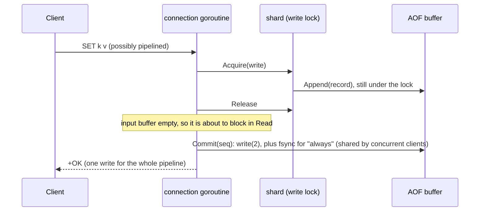

# carpincho

A **Redis-compatible in-memory database server written in Go**, built from scratch: RESP2 protocol, TCP server, strings / lists / hashes / sets, key expiry, pub/sub and an append-only-file persistence layer with crash recovery.

It speaks the Redis wire protocol, so `redis-cli`, `go-redis` and any other Redis client work against it unchanged. It is a learning-grade engineering project, **not** a production Redis replacement: the goal is a codebase small enough to read in an afternoon that still makes the real design decisions (networking, concurrency, durability, testing) and documents them.

[](https://github.com/MaxDCoc/carpincho/actions/workflows/ci.yml)

```text
$ redis-cli -p 6380
127.0.0.1:6380> SET greeting "hola carpincho" EX 60
OK
127.0.0.1:6380> GET greeting
"hola carpincho"
127.0.0.1:6380> LPUSH jobs a b c
(integer) 3
127.0.0.1:6380> TYPE jobs
list
```

## Highlights

- **Streaming RESP2 parser/writer** with pipelining and inline commands, hardened with Go native fuzz tests (a lying length prefix can't make it allocate 512 MB).
- **One goroutine per connection**, replies batched per pipeline (one `write` per burst of commands), graceful shutdown that drains in-flight commands.
- **Sharded keyspace**: 256 shards, one `RWMutex` each, locks always taken in index order. About **11x faster** than a single global lock under a 16-core 90/10 read/write mix (measured, see [Benchmarks](#benchmarks)). Rationale in [ADR 0001](docs/adr/0001-concurrency-model.md).
- **Expiry like Redis**: lazy on access plus an active cycle that samples 20 TTL keys per round and repeats while more than 25% were expired, with a time budget.
- **Append-only file** with `always` / `everysec` / `no` fsync, **group commit**, replay that **tolerates a truncated tail**, absolute expiry timestamps, and `BGREWRITEAOF` compaction ([ADR 0002](docs/adr/0002-aof-rewrite.md)).
- **Redis-identical replies and errors** (`WRONGTYPE`, `ERR value is not an integer or out of range`, unknown-command text, ...), checked by table-driven tests and by `go-redis`.
- Slow pub/sub subscribers are disconnected instead of stalling publishers.

## Quick start

Requirements: Go 1.26+ (the module declares it). No other dependency at runtime.

```bash
git clone https://github.com/MaxDCoc/carpincho.git && cd carpincho
go build -o bin/carpincho ./cmd/carpincho
./bin/carpincho --port 6380 --dir ./data --appendfsync everysec
```

Then, from another terminal:

```bash
redis-cli -p 6380 PING            # or: docker run --rm redis:7-alpine redis-cli -h host.docker.internal -p 6380 PING
```

| Flag | Default | Meaning |
|------|---------|---------|
| `--port` | `6380` | TCP port. 6380 on purpose, so it never clashes with a real Redis on 6379. |
| `--bind` | `127.0.0.1` | Listen address. Use `0.0.0.0` inside containers. There is no authentication, so keep it local. |
| `--dir` | *(empty)* | Data directory for `appendonly.aof`. Empty = pure in-memory, nothing is persisted. |
| `--appendfsync` | `everysec` | `always` (fsync before replying), `everysec` (fsync once per second), `no` (leave it to the OS). |

With Docker:

```bash
docker build -t carpincho .
docker run --rm -p 6380:6380 -v carpincho-data:/data carpincho
```

Other targets: `make test`, `make race`, `make fuzz`, `make bench`, `make bench-docker` (see `Makefile`).

## Supported commands

| Group | Commands |
|-------|----------|
| Connection / server | `PING [msg]`, `ECHO`, `QUIT`, `HELLO [2]` (RESP2 only; `HELLO 3` answers `-NOPROTO`, clients fall back), `COMMAND` (stub so `redis-cli` starts; `COUNT` / `LIST` are real), `INFO [section]`, `CLIENT SETNAME / GETNAME / ID / SETINFO`, `CONFIG GET` (read-only), `SELECT 0`, `BGREWRITEAOF` |
| Strings | `GET`, `SET key value [NX \| XX] [EX \| PX \| EXAT \| PXAT \| KEEPTTL]`, `MGET`, `MSET`, `INCR`, `DECR`, `INCRBY`, `DECRBY`, `APPEND`, `STRLEN` |
| Keys | `DEL` (`UNLINK`), `EXISTS`, `EXPIRE`, `PEXPIRE`, `EXPIREAT`, `PEXPIREAT`, `TTL`, `PTTL`, `PERSIST`, `TYPE`, `KEYS pattern` (glob: `* ? [abc] [a-z] [^a] \`), `DBSIZE`, `FLUSHALL` (`FLUSHDB`) |
| Lists | `LPUSH`, `RPUSH`, `LPOP [count]`, `RPOP [count]`, `LRANGE`, `LLEN` |
| Hashes | `HSET` (several pairs), `HGET`, `HDEL`, `HGETALL`, `HLEN` |
| Sets | `SADD`, `SREM`, `SMEMBERS`, `SISMEMBER`, `SCARD` |
| Pub/Sub | `SUBSCRIBE`, `UNSUBSCRIBE`, `PUBLISH` |

Not implemented yet (and written up as ready-to-paste issues in [`docs/issues/`](docs/issues)): sorted sets, RDB snapshots, `maxmemory` eviction, `MULTI/EXEC/WATCH`, replication, RESP3, keyspace notifications, Prometheus metrics. Also missing: `PSUBSCRIBE`, the `NX/XX/GT/LT` options of `EXPIRE`, the `GET` option of `SET`, authentication, TLS and multiple databases.

## Architecture


The path of a write, and why a client never sees `OK` for data that is not in the log:



Package layout:

| Path | Responsibility |
|------|----------------|
| `internal/resp` | RESP2 reader (multibulk + inline + replies), writer, fuzz tests |
| `internal/store` | Sharded keyspace, TTLs, active expiry, list deque, glob matcher |
| `internal/aof` | Append-only file: fsync policies, group commit, replay, rewrite |
| `internal/server` | Listener, connection loop, command table and all commands, pub/sub, INFO |
| `cmd/carpincho` | Flags, signals, graceful shutdown |
| `docs/` | ADRs, issue drafts for the roadmap, study guide (Spanish) |

## Design decisions

Short version; the reasoning and the alternatives are in the ADRs.

1. **Goroutine per connection instead of an event loop.** Idiomatic Go, simple blocking code, and the runtime multiplexes thousands of idle connections. The price is that a client that never reads its replies can block its own goroutine on a full socket buffer. Redis keeps per-client output buffers with limits; carpincho does not (known limitation).
2. **Sharded `RWMutex` instead of one lock or a single-threaded executor.** Reads of different keys never contend and use all cores. Multi-key commands (`MSET`, `DEL a b`) lock the distinct shards they touch in ascending order, so they cannot deadlock. The cost is that cross-key transactions (`MULTI/EXEC`) need extra machinery, written up in [issue 04](docs/issues/04-multi-exec-watch.md).
3. **Never do I/O while holding a shard lock.** Handlers copy what they need out of the store, release the lock, then write to the socket. A stalled client can't freeze a shard. String values are immutable once stored, which is what makes the copy a pointer copy.
4. **Reply batching by "flush before you block".** The connection reads through a wrapper that flushes pending replies right before a `Read` that could block, so a pipeline of N commands costs one write syscall and a lone command is answered immediately.
5. **Durability = AOF in the Redis format.** Records are appended while the shard lock is held (so log order equals apply order per key), made durable by `Commit` before the reply is sent. Relative expirations are logged as absolute `PXAT` timestamps; expiry is suspended while replaying so history is not rewritten by the passage of time.
6. **Rewrite without `fork`.** Go can't fork a copy-on-write child, so `BGREWRITEAOF` holds read locks on all shards while it dumps and swaps the file; writers pause for the duration of the dump. The fuzzy-snapshot alternative is wrong for non-idempotent commands like `INCR` ([ADR 0002](docs/adr/0002-aof-rewrite.md)).

## Testing

```bash
go test ./...                 # unit + persistence + go-redis integration tests (in-process server)
go test -race ./...           # the same, with the race detector (what CI runs on Linux)
make fuzz                     # 30 s of native fuzzing on each RESP target
```

- **Parser**: table tests, byte-at-a-time streaming, truncated inputs, protocol error texts, allocation bound for lying lengths, and three fuzz targets (`FuzzReadCommand`, `FuzzReadValue`, `FuzzSplitInline`) with round-trip properties.
- **Commands**: a harness runs commands in-process and renders replies like `redis-cli`, so a test reads like a session; WRONGTYPE matrix, option parsing, error texts.
- **Integration**: `go-redis` v9 against a real loopback server: all data types, 2000-command pipelines, a 1 MiB value, 50 concurrent clients, pub/sub fan-out, `HELLO 3` fallback, raw wire-format checks, graceful shutdown, restart.
- **Persistence**: restart with each fsync policy, relative-to-absolute expiry, replay without early expiry, torn last record, rewrite compaction, and a test that runs `BGREWRITEAOF` in a loop while 8 goroutines increment counters and then checks every counter is exact after a restart.

## Benchmarks

Measured with `go test -bench` on the author's machine: Windows 11, AMD Ryzen 7 7735H (8 cores / 16 threads), 16 GB RAM, Go 1.26.2, loopback. The machine was running other applications and the load generator shares the CPU with the server, so read these as orders of magnitude, not as a leaderboard.

| Benchmark | Result |
|-----------|--------|
| Store, 90% get / 10% set, 16 goroutines, **256 shards** | **29 ns/op** |
| Same workload, **one global `RWMutex`** | 346 ns/op (11.7x slower) |
| Command layer, no sockets, GET / SET / INCR (16 goroutines, wall time per op) | 179 / 318 / 143 ns |
| TCP loopback, GET, pipeline depth 1 / 16 / 128 (16 connections) | 121 K / 1.58 M / 5.19 M cmds/s |
| TCP loopback, SET, pipeline depth 1 / 16 / 128 (16 connections) | 134 K / 841 K / 2.32 M cmds/s |
| RESP parse of a pipelined `SET` (13 B key, 64 B value) | 1.03 µs, 100 MB/s, 7 allocs |
| RESP bulk reply encode | 96 ns, 0 allocs |

**Comparison with Redis 7: deliberately not run, so there are no numbers.** When this was written the development machine had Docker stopped and almost no free disk space, and pulling images was not an option, so the `redis-benchmark` comparison was skipped; nothing here is estimated or extrapolated. [`bench/run-docker-bench.sh`](bench/run-docker-bench.sh) runs both servers in containers on one network with the same CPU limit and drives them with `redis-benchmark` from the `redis:7-alpine` image (`make bench-docker`; set `TARGET=host.docker.internal:6380` to also test a natively running carpincho). Paste its output here when you run it. Expect Redis to be faster per core; the point of this project is correctness and clarity, not beating a decade of C tuning.

## Known limitations

- No authentication or TLS: bind to localhost.
- A single database (`SELECT 0` only) and no `maxmemory`: memory use is unbounded.
- No output-buffer limit for normal clients (only for subscribers).
- `BGREWRITEAOF` pauses writers while it dumps (see ADR 0002).
- `KEYS` and `DBSIZE` are not atomic snapshots under concurrent writes.
- The race detector was not run on the author's Windows machine (it needs a C toolchain); the CI workflow runs it on Linux.

## Roadmap

Each item is a self-contained, ready-to-paste GitHub issue with acceptance criteria and the files to touch, ordered here from easiest to hardest:

1. [Prometheus metrics](docs/issues/08-prometheus-metrics.md)
2. [RESP3](docs/issues/06-resp3.md)
3. [Keyspace notifications](docs/issues/07-keyspace-notifications.md)
4. [Sorted sets with a skip list](docs/issues/01-sorted-sets-skiplist.md)
5. [RDB snapshots](docs/issues/02-rdb-snapshots.md)
6. [`maxmemory` with approximate LRU/LFU eviction](docs/issues/03-maxmemory-lru-lfu-eviction.md)
7. [`MULTI` / `EXEC` / `WATCH`](docs/issues/04-multi-exec-watch.md)
8. [Replication with `REPLICAOF`](docs/issues/05-replication-replicaof.md)

## About this project

carpincho was started with AI assistance as a scaffold and is being taken over by its author, who is building the roadmap features by hand. `docs/GUIA-MAX.md` (Spanish) is the author's own study guide to the code.

## License

MIT, see [LICENSE](LICENSE).
