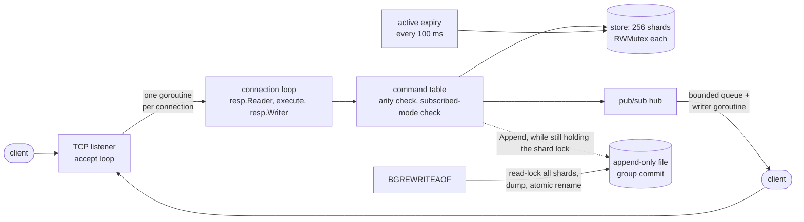
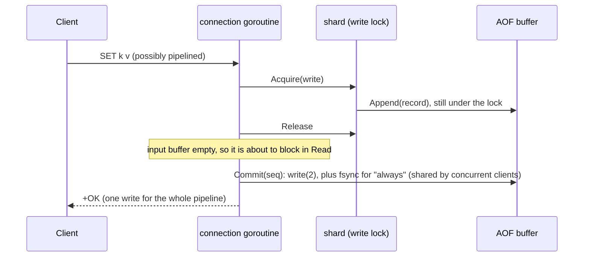

# carpincho

A **Redis-compatible in-memory database server written in Go**, built from scratch: RESP2 protocol, TCP server, strings / lists / hashes / sets, key expiry, pub/sub and an append-only-file persistence layer with crash recovery.

It speaks the Redis wire protocol, so `redis-cli`, `go-redis` and any other Redis client work against it unchanged. It is a learning-grade engineering project, **not** a production Redis replacement: the goal is a codebase small enough to read in an afternoon that still makes the real design decisions (networking, concurrency, durability, testing) and documents them.

[](https://github.com/MaxDCoc/carpincho/actions/workflows/ci.yml)

```text
$ redis-cli -p 6380
127.0.0.1:6380> SET greeting "hola carpincho" EX 60
OK
127.0.0.1:6380> GET greeting
"hola carpincho"
127.0.0.1:6380> LPUSH jobs a b c
(integer) 3
127.0.0.1:6380> TYPE jobs
list
```

## Highlights

- **Streaming RESP2 parser/writer** with pipelining and inline commands, hardened with Go native fuzz tests (a lying length prefix can't make it allocate 512 MB).
- **One goroutine per connection**, replies batched per pipeline (one `write` per burst of commands), graceful shutdown that drains in-flight commands.
- **Sharded keyspace**: 256 shards, one `RWMutex` each, locks always taken in index order. About **11x faster** than a single global lock under a 16-core 90/10 read/write mix (measured, see [Benchmarks](#benchmarks)). Rationale in [ADR 0001](docs/adr/0001-concurrency-model.md).
- **Expiry like Redis**: lazy on access plus an active cycle that samples 20 TTL keys per round and repeats while more than 25% were expired, with a time budget.
- **Append-only file** with `always` / `everysec` / `no` fsync, **group commit**, replay that **tolerates a truncated tail**, absolute expiry timestamps, and `BGREWRITEAOF` compaction ([ADR 0002](docs/adr/0002-aof-rewrite.md)).
- **Redis-identical replies and errors** (`WRONGTYPE`, `ERR value is not an integer or out of range`, unknown-command text, ...), checked by table-driven tests and by `go-redis`.
- Slow pub/sub subscribers are disconnected instead of stalling publishers.
- Checked against the real tools: `redis-cli` 7.4.11 and `redis-benchmark` against Redis 7.4.11 (see [Benchmarks](#comparison-with-redis-7-redis-benchmark)). In a like-for-like container setup carpincho handled 88 to 97% of Redis' requests per second without pipelining; with pipelining there is no honest ranking, the result flips with the load generator's setup.

## Quick start

Requirements: Go 1.26+ (the module declares it). No other dependency at runtime.

```bash
git clone https://github.com/MaxDCoc/carpincho.git && cd carpincho
go build -o bin/carpincho ./cmd/carpincho
./bin/carpincho --port 6380 --dir ./data --appendfsync everysec
```

Then, from another terminal:

```bash
redis-cli -p 6380 PING            # or: docker run --rm redis:7-alpine redis-cli -h host.docker.internal -p 6380 PING
```

| Flag | Default | Meaning |
|------|---------|---------|
| `--port` | `6380` | TCP port. 6380 on purpose, so it never clashes with a real Redis on 6379. |
| `--bind` | `127.0.0.1` | Listen address. Use `0.0.0.0` inside containers. There is no authentication, so keep it local. |
| `--dir` | *(empty)* | Data directory for `appendonly.aof`. Empty = pure in-memory, nothing is persisted. |
| `--appendfsync` | `everysec` | `always` (fsync before replying), `everysec` (fsync once per second), `no` (leave it to the OS). |

With Docker:

```bash
docker build -t carpincho .
docker run --rm -p 6380:6380 -v carpincho-data:/data carpincho
```

Other targets: `make test`, `make race`, `make fuzz`, `make bench`, `make bench-docker` (see `Makefile`).

## Supported commands

| Group | Commands |
|-------|----------|
| Connection / server | `PING [msg]`, `ECHO`, `QUIT`, `HELLO [2]` (RESP2 only; `HELLO 3` answers `-NOPROTO`, clients fall back), `COMMAND` (stub so `redis-cli` starts; `COUNT` / `LIST` are real), `INFO [section]`, `CLIENT SETNAME / GETNAME / ID / SETINFO`, `CONFIG GET` (read-only), `SELECT 0`, `BGREWRITEAOF` |
| Strings | `GET`, `SET key value [NX \| XX] [EX \| PX \| EXAT \| PXAT \| KEEPTTL]`, `MGET`, `MSET`, `INCR`, `DECR`, `INCRBY`, `DECRBY`, `APPEND`, `STRLEN` |
| Keys | `DEL` (`UNLINK`), `EXISTS`, `EXPIRE`, `PEXPIRE`, `EXPIREAT`, `PEXPIREAT`, `TTL`, `PTTL`, `PERSIST`, `TYPE`, `KEYS pattern` (glob: `* ? [abc] [a-z] [^a] \`), `DBSIZE`, `FLUSHALL` (`FLUSHDB`) |
| Lists | `LPUSH`, `RPUSH`, `LPOP [count]`, `RPOP [count]`, `LRANGE`, `LLEN` |
| Hashes | `HSET` (several pairs), `HGET`, `HDEL`, `HGETALL`, `HLEN` |
| Sets | `SADD`, `SREM`, `SMEMBERS`, `SISMEMBER`, `SCARD` |
| Pub/Sub | `SUBSCRIBE`, `UNSUBSCRIBE`, `PUBLISH` |

Not implemented yet (and written up as ready-to-paste issues in [`docs/issues/`](docs/issues)): sorted sets, RDB snapshots, `maxmemory` eviction, `MULTI/EXEC/WATCH`, replication, RESP3, keyspace notifications, Prometheus metrics. Also missing: `SCAN` (so `redis-cli --scan` and `--bigkeys` do not work), `PSUBSCRIBE`, the `NX/XX/GT/LT` options of `EXPIRE`, the `GET` option of `SET`, authentication, TLS and multiple databases.

## Architecture



The path of a write, and why a client never sees `OK` for data that is not in the log:



Package layout:

| Path | Responsibility |
|------|----------------|
| `internal/resp` | RESP2 reader (multibulk + inline + replies), writer, fuzz tests |
| `internal/store` | Sharded keyspace, TTLs, active expiry, list deque, glob matcher |
| `internal/aof` | Append-only file: fsync policies, group commit, replay, rewrite |
| `internal/server` | Listener, connection loop, command table and all commands, pub/sub, INFO |
| `cmd/carpincho` | Flags, signals, graceful shutdown |
| `docs/` | ADRs, issue drafts for the roadmap, study guide (Spanish) |

## Design decisions

Short version; the reasoning and the alternatives are in the ADRs.

1. **Goroutine per connection instead of an event loop.** Idiomatic Go, simple blocking code, and the runtime multiplexes thousands of idle connections. The price is that a client that never reads its replies can block its own goroutine on a full socket buffer. Redis keeps per-client output buffers with limits; carpincho does not (known limitation).
2. **Sharded `RWMutex` instead of one lock or a single-threaded executor.** Reads of different keys never contend and use all cores. Multi-key commands (`MSET`, `DEL a b`) lock the distinct shards they touch in ascending order, so they cannot deadlock. The cost is that cross-key transactions (`MULTI/EXEC`) need extra machinery, written up in [issue 04](docs/issues/04-multi-exec-watch.md).
3. **Never do I/O while holding a shard lock.** Handlers copy what they need out of the store, release the lock, then write to the socket. A stalled client can't freeze a shard. String values are immutable once stored, which is what makes the copy a pointer copy.
4. **Reply batching by "flush before you block".** The connection reads through a wrapper that flushes pending replies right before a `Read` that could block, so a pipeline of N commands costs one write syscall and a lone command is answered immediately.
5. **Durability = AOF in the Redis format.** Records are appended while the shard lock is held (so log order equals apply order per key), made durable by `Commit` before the reply is sent. Relative expirations are logged as absolute `PXAT` timestamps; expiry is suspended while replaying so history is not rewritten by the passage of time.
6. **Rewrite without `fork`.** Go can't fork a copy-on-write child, so `BGREWRITEAOF` holds read locks on all shards while it dumps and swaps the file; writers pause for the duration of the dump. The fuzzy-snapshot alternative is wrong for non-idempotent commands like `INCR` ([ADR 0002](docs/adr/0002-aof-rewrite.md)).

## Testing

```bash
go test ./...                 # unit + persistence + go-redis integration tests (in-process server)
go test -race ./...           # the same, with the race detector (what CI runs on Linux)
make fuzz                     # 30 s of native fuzzing on each RESP target
```

- **Parser**: table tests, byte-at-a-time streaming, truncated inputs, protocol error texts, allocation bound for lying lengths, and three fuzz targets (`FuzzReadCommand`, `FuzzReadValue`, `FuzzSplitInline`) with round-trip properties.
- **Commands**: a harness runs commands in-process and renders replies like `redis-cli`, so a test reads like a session; WRONGTYPE matrix, option parsing, error texts.
- **Integration**: `go-redis` v9 against a real loopback server: all data types, 2000-command pipelines, a 1 MiB value, 50 concurrent clients, pub/sub fan-out, `HELLO 3` fallback, raw wire-format checks, graceful shutdown, restart.
- **Persistence**: restart with each fsync policy, relative-to-absolute expiry, replay without early expiry, torn last record, rewrite compaction, and a test that runs `BGREWRITEAOF` in a loop while 8 goroutines increment counters and then checks every counter is exact after a restart.
- **Real Redis tools**: `redis-cli` 7.4.11 and `redis-benchmark` from the official `redis:7-alpine` image against the running server. The transcript in [`docs/redis-cli-session.txt`](docs/redis-cli-session.txt) covers strings with TTL, lists, hashes, sets, errors, `redis-cli --pipe` (1000 commands in one burst) and pub/sub, and then kills the server process hard and reads everything back after a restart (1007 keys, TTL included).

## Benchmarks

### Go micro-benchmarks

Measured with `go test -bench` on the author's machine: Windows 11, AMD Ryzen 7 7735H (8 cores / 16 threads), 16 GB RAM, Go 1.26.2, loopback. The machine was running other applications and the load generator shares the CPU with the server, so read these as orders of magnitude, not as a leaderboard.

| Benchmark | Result |
|-----------|--------|
| Store, 90% get / 10% set, 16 goroutines, **256 shards** | **29 ns/op** |
| Same workload, **one global `RWMutex`** | 346 ns/op (11.7x slower) |
| Command layer, no sockets, GET / SET / INCR (16 goroutines, wall time per op) | 179 / 318 / 143 ns |
| TCP loopback, GET, pipeline depth 1 / 16 / 128 (16 connections) | 121 K / 1.58 M / 5.19 M cmds/s |
| TCP loopback, SET, pipeline depth 1 / 16 / 128 (16 connections) | 134 K / 841 K / 2.32 M cmds/s |
| RESP parse of a pipelined `SET` (13 B key, 64 B value) | 1.03 µs, 100 MB/s, 7 allocs |
| RESP bulk reply encode | 96 ns, 0 allocs |

### Comparison with Redis 7 (`redis-benchmark`)

`redis-benchmark` 7.4.11 (from the official `redis:7-alpine` image) drove carpincho and Redis 7.4.11 with identical flags. Everything is scripted in [`bench/run-docker-bench.sh`](bench/run-docker-bench.sh) (`make bench-docker`), the raw per-run numbers are committed in [`bench/results/`](bench/results), and `awk -f bench/summarize.awk <file>` condenses them into tables like the ones below.

**Machine.** The same laptop as above: Windows 11 Pro (10.0.26200), AMD Ryzen 7 7735H (8 cores / 16 threads), 15.2 GB RAM, Docker Desktop 28.5.1 on WSL2 (its VM sees 16 CPUs and 7.4 GiB), Go 1.26.2. It was **not idle**: about 25% CPU of background load (a desktop assistant, Discord, a game launcher) and only 1.2 GB of free RAM while the benchmarks ran.

**Method.** 50 connections, random keys out of 100 000, every measurement taken twice and interleaved (carpincho, Redis, carpincho, Redis), keyspace flushed and a warm-up pass before each. Neither server persists anything (`--save "" --appendonly no` for Redis, no `--dir` for carpincho). Tables show the mean of the two runs, in requests per second.

#### Like for like: same kernel, same network, same CPU limit (`MODE=network`)

carpincho (the static linux/amd64 binary, run inside a `redis:7-alpine` container that is only used as a root filesystem; the Redis server is not started there) and Redis each run in a container limited to 2 CPUs on one Docker network, and `redis-benchmark` reaches both directly. **This is the comparison to use.**

Without pipelining (`-P 1`, 100 000 requests per test, runs of 5 to 15 s; the two runs of a measurement differed by 3% on average and 12% at most):

| test | carpincho | Redis | ratio | p50 carpincho | p50 Redis |
|---|--:|--:|--:|--:|--:|
| PING_MBULK | 18066 | 20096 | 0.90x | 1.37 ms | 1.22 ms |
| SET | 18609 | 20925 | 0.89x | 1.32 ms | 1.21 ms |
| GET | 19307 | 20660 | 0.93x | 1.28 ms | 1.22 ms |
| INCR | 19368 | 20044 | 0.97x | 1.28 ms | 1.23 ms |
| LPUSH | 19144 | 21642 | 0.88x | 1.31 ms | 1.21 ms |
| RPUSH | 19512 | 20623 | 0.95x | 1.27 ms | 1.20 ms |
| LPOP | 19098 | 21193 | 0.90x | 1.31 ms | 1.19 ms |
| RPOP | 19462 | 21308 | 0.91x | 1.27 ms | 1.19 ms |
| SADD | 19140 | 21315 | 0.90x | 1.31 ms | 1.20 ms |
| HSET | 19348 | 20985 | 0.92x | 1.29 ms | 1.20 ms |
| LRANGE_100 | 6946 | 6446 | 1.08x | 3.51 ms | 3.74 ms |
| MSET (10 keys) | 19291 | 21749 | 0.89x | 1.31 ms | 1.26 ms |

With 16 commands per round trip (`-P 16`; 1 000 000 requests per test with one generator thread, 2 000 000 with four; the two runs of a measurement differed by 9% and 7% on average and by 55% at most, carpincho `HSET`: 299 581 and 170 678):

| test | 1 thread: carpincho | Redis | ratio | 4 threads: carpincho | Redis | ratio |
|---|--:|--:|--:|--:|--:|--:|
| PING_MBULK | 266152 | 306660 | 0.87x | 484499 | 238533 | 2.03x |
| SET | 280186 | 295908 | 0.95x | 307314 | 194837 | 1.58x |
| GET | 273117 | 317260 | 0.86x | 347132 | 173595 | 2.00x |
| INCR | 299861 | 310085 | 0.97x | 313578 | 202413 | 1.55x |
| LPUSH | 270869 | 189609 | 1.43x | 366153 | 150658 | 2.43x |
| RPUSH | 276529 | 313471 | 0.88x | - | - | - |
| LPOP | 290622 | 309834 | 0.94x | - | - | - |
| RPOP | 287385 | 308605 | 0.93x | - | - | - |
| SADD | 261344 | 297269 | 0.88x | - | - | - |
| HSET | 235129 | 266575 | 0.88x | - | - | - |
| MSET (10 keys) | 90059 | 93091 | 0.97x | 96804 | 86336 | 1.12x |

What the numbers support:

- **No pipelining: carpincho is slightly behind.** It handles 88 to 97% of Redis' requests per second in 11 of 12 tests, and its median latency is 0.04 to 0.15 ms higher (1.27 to 1.37 ms against 1.19 to 1.26 ms). The gap is about the same for every command, which looks like a fixed per-request cost rather than slower commands. My guess is the goroutine wake-up in Go's network poller against Redis' epoll loop, but I did not measure that. `LRANGE_100` is the exception (1.08x): both are limited by building and sending 100 replies.
- **Depth 16, one generator thread: carpincho is 3 to 14% behind in 10 of 11 tests.** Both servers sit around 235 to 320 K req/s on single-key commands (`MSET` carries 10 keys, hence ~90 K), which is close to what one `redis-benchmark` thread can generate. `LPUSH` is the outlier (1.43x) because Redis' own `LPUSH` ran well below its other write commands (190 K against about 300 K), which I cannot explain.
- **Depth 16, four generator threads: the order flips**, with carpincho ahead by 1.1 to 2.4x. That fits the design (a 2-CPU quota lets carpincho run commands from several connections in parallel, while Redis executes commands on one thread), but it is not proof: Redis' own throughput also fell to 150 to 240 K req/s, below what it reached with one generator thread, and I have not found out why.
- So **there is no honest ranking at depth 16**: the winner depends on how the load is generated. What the data does show is that carpincho is in the same range as Redis 7.4 for simple commands on this laptop, a few percent behind per request without pipelining.

#### Through Docker Desktop's networking, carpincho as a native Windows process (`MODE=host`)

The obvious setup: carpincho runs natively on Windows, Redis in a container with its port published on `127.0.0.1:6381`, and `redis-benchmark` in a third container reaching both through `host.docker.internal`, so **both go through Docker Desktop's network layer**. It is biased and must not be used to rank the servers: the two sit on different operating systems and the paths differ (Redis' published port takes extra hops). That is why Redis' median latency was 4.9 to 6.4 ms against 2.9 to 4.2 ms for carpincho, and why at `-P 1` both were capped at roughly 5 to 11 K req/s by the proxy. These were also the noisiest runs (the two runs of a measurement differed by 13% on average and 51% at most). Kept as a record, `-P 1` only:

<details><summary>Table</summary>

| test | carpincho | Redis | ratio | p50 carpincho | p50 Redis |
|---|--:|--:|--:|--:|--:|
| PING_MBULK | 9748 | 6871 | 1.42x | 3.43 ms | 6.38 ms |
| SET | 9265 | 7255 | 1.28x | 3.61 ms | 5.88 ms |
| GET | 8450 | 8129 | 1.04x | 3.97 ms | 5.07 ms |
| INCR | 9718 | 8652 | 1.12x | 3.34 ms | 4.89 ms |
| LPUSH | 10396 | 8290 | 1.25x | 3.20 ms | 5.12 ms |
| RPUSH | 11050 | 8451 | 1.31x | 2.95 ms | 5.03 ms |
| LPOP | 11272 | 8608 | 1.31x | 2.90 ms | 4.93 ms |
| RPOP | 10530 | 8604 | 1.22x | 3.07 ms | 4.93 ms |
| SADD | 9843 | 8689 | 1.13x | 3.44 ms | 4.85 ms |
| HSET | 10299 | 8491 | 1.21x | 3.14 ms | 5.00 ms |
| LRANGE_100 | 5045 | 5155 | 0.98x | 5.21 ms | 5.78 ms |
| MSET (10 keys) | 8807 | 8596 | 1.02x | 4.20 ms | 4.98 ms |

</details>

The `-P 16` rows of that file and of the first `-network.tsv` come from 100 000-request runs that lasted 0.3 to 0.7 s: too short to mean anything, and in `--threads` mode `redis-benchmark` times a run in 250 ms steps. They stay in the raw files but are not used here; the depth-16 numbers above come from the two `*-long-p16.tsv` files.

#### Caveats

- Two runs per measurement on a shared laptop that was running other programs. Treat differences smaller than the run-to-run spread as noise unless they repeat consistently, as the `-P 1` gap does (11 of 12 tests on the same side).
- At `-P 1` both servers sit near 20 K req/s, which is the cost of Docker's virtual network plus a single generator thread, not what either server can do. The 3 to 12% gap is small next to that shared cost.
- carpincho had a quota of 2 CPUs and Redis runs commands on one thread; another `CPUS=` changes the picture at depth 16.
- Not measured: persistence on (AOF `everysec` / `always` against Redis `appendonly yes`), values larger than a few bytes, more than 50 connections, `LRANGE` with pipelining.
- Run `make bench-docker` again on an idle machine before quoting any of this.

## Known limitations

- No authentication or TLS: bind to localhost.
- A single database (`SELECT 0` only) and no `maxmemory`: memory use is unbounded.
- No output-buffer limit for normal clients (only for subscribers).
- `BGREWRITEAOF` pauses writers while it dumps (see ADR 0002).
- `KEYS` and `DBSIZE` are not atomic snapshots under concurrent writes.
- The race detector cannot run on the author's Windows machine (it needs a C toolchain); CI runs `go test -race` on Linux on every push.
- The `Dockerfile` is built by CI on every push and the image is smoke-tested with `PING`; it has not been run by hand on the author's machine. The benchmarks use the same static binary cross-compiled with `CGO_ENABLED=0`.

## Roadmap

Each item is a self-contained, ready-to-paste GitHub issue with acceptance criteria and the files to touch, ordered here from easiest to hardest:

1. [Prometheus metrics](docs/issues/08-prometheus-metrics.md)
2. [RESP3](docs/issues/06-resp3.md)
3. [Keyspace notifications](docs/issues/07-keyspace-notifications.md)
4. [Sorted sets with a skip list](docs/issues/01-sorted-sets-skiplist.md)
5. [RDB snapshots](docs/issues/02-rdb-snapshots.md)
6. [`maxmemory` with approximate LRU/LFU eviction](docs/issues/03-maxmemory-lru-lfu-eviction.md)
7. [`MULTI` / `EXEC` / `WATCH`](docs/issues/04-multi-exec-watch.md)
8. [Replication with `REPLICAOF`](docs/issues/05-replication-replicaof.md)

## About this project

carpincho was built with AI assistance (Claude Code) as a scaffold for its author to take over. None of the roadmap items above is implemented yet. `docs/GUIA-MAX.md` (Spanish) is a study guide to the code, written for the author.

## License

MIT, see [LICENSE](LICENSE).
